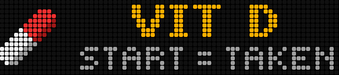
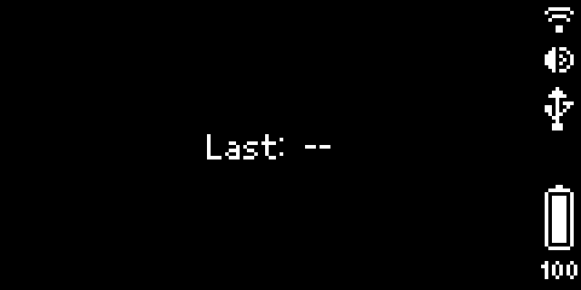
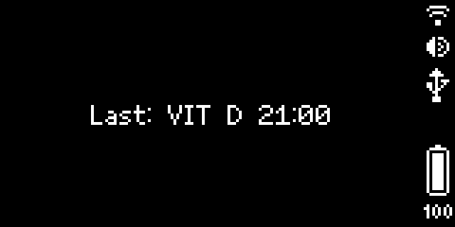

# Pill Reminder

Reminds you to take your pills on time.



Set up to four doses in the settings, each with a name and a time. The bar shows the clock and the next dose, and when a dose is due it shakes a capsule on the front display, plays a sound and blinks the status light until you press Start. The back display shows the last dose you took.

A JavaScript app for [BUSY Bar](https://busy.app).

## What the bar shows

Between doses the front display shows the clock and, under it, the next dose that is on and its time.


With every dose off in the settings, `--` takes the place of the next dose.


The back display shows the last dose taken and the time Start was pressed for it; before the first one it shows `Last: --`.



When a dose's time comes, the front display shows a capsule shaking left of the dose name and `START = TAKEN`, a sound plays and the status light blinks amber. A name too wide for the large font is written in the small one. The reminder stays for that minute, then the clock comes back; until Start is pressed, the reminder, the sound and the blink come back every repeat interval, 10 minutes by default. When several doses are due at once, they come one at a time: Start on one shows the next.

Start while a reminder is on the display marks the dose as taken, and the back display shows it.



The BUSY Bar runs one app at a time, so reminders come only while this app is open.

## Buttons

| Button | What it does |
| --- | --- |
| Start | Marks the dose on the display as taken. |
| Back | Quits the app. |

## Settings

| Setting | What it does |
| --- | --- |
| Dose 1 to Dose 4: Name | The name on the display, Latin letters, up to 10. VIT D for Dose 1 by default, empty for the others. |
| Dose 1 to Dose 4: Time | When the dose is due, every day. 21:00 by default. |
| Dose 1 to Dose 4: On | Whether the dose is reminded of. On for Dose 1 by default, off for the others. |
| Remind again after, minutes | How long after a reminder it comes back while Start is not pressed, 1 to 240 minutes. 10 by default. |

The app reads its settings when it starts.

## Data

None from the network: the app works offline. It keeps on the BUSY Bar, in its local storage, the last dose taken, for the back display, and a journal of the doses taken in the last 30 days.

## Build

Node 24 and npm:

```sh
npm ci
npm run build         # dist/io.github.vvzvlad.pills.tgz
npm run app:install   # install it on a BUSY Bar connected over USB
npm run app:run       # start it
```

## License

[MIT](LICENSE)
